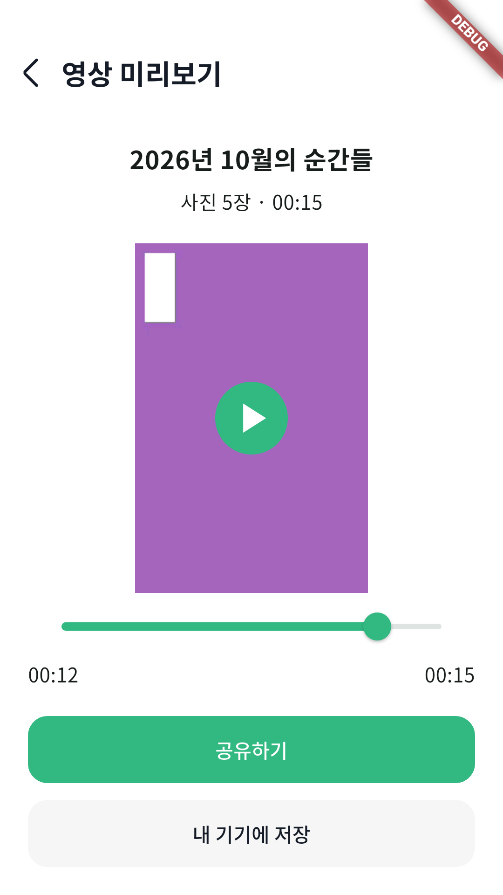

# 반려로그 UI·영상 진행률 검증

기준: `origin/develop`의 `aee12d2a9c31dcf465f05bd216effc78cfbb4955`.
작업 브랜치: `feat/pet-log-screen-polish`. Android MuMu에서 합성 사진만 사용했다.

## 디자인 대응

[Figma 영상 흐름](https://www.figma.com/design/MYwSnxdhmGZnLuc1pHtjZz?node-id=1686-1423),
[승인한 한도 안내](https://www.figma.com/design/MYwSnxdhmGZnLuc1pHtjZz?node-id=1958-2).

| 상태 | 구현 및 비교 기준 | 검증 |
|---|---|---|
| 30 선택 완료 | 2열 사진, 선택 번호·날짜, 전체 해제, 수·길이, 정렬 | Flutter + MuMu |
| 31 제작 중 | 사진 준비/프레임 기록 진행률 구분, 제작 취소 | MuMu 생성, 서비스 이벤트 테스트 |
| 32 미리보기 | 기간·실제 길이, 재생·탐색, 공유 위/저장 아래 | MuMu |
| 33 저장 완료 | 공용 저장 완료 토스트 | 실제 Android 갤러리 저장 |
| 34 선택 전 | 0장, 만들기 비활성, 선택 후 활성 | Flutter |
| 35 제작 실패 | 선택 보존, 다시 만들기/사진 다시 고르기 | 코드 검토; 실제 기기 인코더 실패 미주입 |
| 36 제작 취소 | 계속 만들기/제작 취소, 선택 화면 복귀 | 다운로드 중 취소 회귀 테스트 |
| 37 권한 안내 | accessDenied만 권한 안내, Android 설정 이동 | Gal 오류 주입; 실제 OS 권한 변경 미실행 |
| 38 공유 연결 | OS 기본 공유 호출, 전송하지 않고 취소 | MuMu |
| 39 저장 실패 | 미리보기 유지, 재시도/돌아가기 | 저장 공간 부족 오류 주입 |
| 40 한도 초과 | 승인 문구·버튼, 중복 방지, 선택 유지 | 이미지·영상 Flutter 테스트 |

전체 보기 제목은 변경했고, 연도 선택은 기존 AppPickerSheet를 사용한다.
핸들은 시트 내부에 위치하며 한 개 옵션은 내용 높이로 표시한다.
큰 글자·작은 화면의 한도 안내는 스크롤 가능하다.

의도적인 시안 차이: 최대 5장, 장당 3초, 실제 영상 비율 유지. 이미지 미리보기는 기존 가로 버튼 배치를 유지한다.
미리보기는 작은 화면에서 영상 영역을 줄이고, 큰 글자/가로 화면에서는 스크롤한다.
Figma 전체 11개 상태의 픽셀 단위 스크린샷 비교는 완료하지 않았다.

## 실행 결과

- `flutter analyze --no-pub`: 오류 없음.
- 전체 Flutter 테스트 1,195개 통과. 관련 테스트 41개도 별도 실행 통과(다운로드 취소 회귀 포함).
- 일반 Android debug APK 및 격리 테스트 APK 빌드 성공.
- MuMu 실제 인코더: 1장 3초/30프레임, 5장 15초/150프레임, 10fps.
- MP4 컨테이너 파싱: 영상 트랙만 존재하며 오디오 트랙 없음.
- 합성 사진은 세로/가로 혼합. 첫 사진 비율(2:3) 캔버스와 전체 사진 맞춤 배치.
- 실제 기록 프레임 진행 이벤트는 단조 증가하며 완료 전 100%를 표시하지 않는다.
- 정지 상태 미리보기, 재생/일시정지/탐색, 실제 갤러리 저장, OS 공유 호출·취소 확인.
- 권한 거부와 저장 공간 부족은 플랫폼 채널 오류 주입으로 확인. 플레이어와 결과 파일을 유지한다.
- 원격 서버를 호출하지 않고 GET 요청을 테스트 응답으로 처리했다. 사용자 기록 생성·수정·삭제/미디어 업로드 없음.



합성 출력: [1장 MP4](verified-1.mp4), [5장 MP4](verified-5.mp4).
서로 다른 색의 합성 사진 0–4를 입력 순서대로 사용한다. 가로 사진은 위아래 검은 여백으로 전체를 표시한다.

## 재현

`frontend`에서:

```sh
flutter analyze --no-pub
flutter test --no-pub test/screens/pet_log test/widgets/pet_log_picker_layout_test.dart test/services/pet_log_video_exporter_native_test.dart test/services/pet_log_export_source_test.dart test/services/pet_log_temp_file_registry_test.dart test/services/pet_log_book_image_composer_test.dart
flutter run --no-pub -t integration_test/pet_log_media_test.dart -d <device> --dart-define=ISOLATED_MEDIA_TEST=true
```

통합 테스트는 `.mediatest` 앱 ID를 검사한 후 합성 파일을 만든다. 로그인/실제 기록은 사용하지 않는다.
공유 화면이 열리면 전송하지 않고 뒤로 돌아온다. 갤러리에는 합성 MP4 한 개가 저장된다.
일반 빌드에는 격리 define을 사용하지 않는다. 배포 시 기존 서명·API·카카오 설정을 적용해야 한다.

## 남은 검증과 배포

- 실제 Android 기기의 다양한 하드웨어 인코더, OS 권한 거부 및 실제 디스크 부족.
- MediaMuxer 파일 마무리 실패의 실제 기기 강제 재현, 앱 프로세스 강제 종료.
- 모든 11개 화면의 Figma 이미지 비교, 다양한 글자 크기의 전체 화면 조합.
- iOS 실행 검증(범위 제외). 진행 이벤트가 없으면 숫자 없는 로딩을 유지한다.
- main 병합, 서명된 release AAB 및 Play 테스트 트랙 업데이트는 별도 단계.

초기 테스트 설정 오류로 기존 디버그 앱 패키지에 테스트 진입점이 설치된 적이 있다.
앱 데이터 삭제는 하지 않았고, 이후 별도 앱 ID 검증을 추가했다. 기존 패키지는 일반 앱 빌드로 복원했다.
복원한 debug 앱의 카카오 로그인은 검증하지 않았다.
